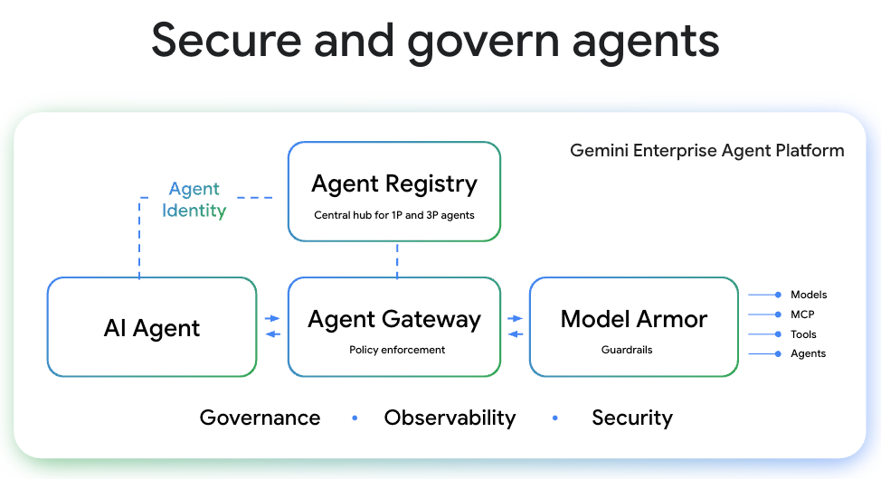

# Gemini Enterprise Agent Platform — Live Governance, Agent Gateway & Model Armor Demo

An interactive Google Cloud demo environment and live visual control plane illustrating how **Agent Registry**, **Agent Gateway**, **Model Armor**, **Agent Identity (`Agent ID`)**, and the **Controlled Security Perimeter (`VPC-SC`, `CMEK`, `DRZ`, `AxT`, `IAM`)** secure 1P (ADK/Gemini) and 3P (Anthropic Claude, Microsoft Copilot Studio) agents and MCP servers.



---

## Key Platform Capabilities Demonstrated

1. **Agent Registry & Dynamic Discovery (A2A & MCP)**:
   - Dynamic onboarding of 3P external agents (e.g. Anthropic Claude, Microsoft Copilot Studio) via standard A2A `.well-known/agent.json` `AgentCard` manifests.
   - Central cataloging and governance of 1P and 3P Model Context Protocol (MCP) servers (BigQuery, Google Workspace, Jira).
2. **Agent Gateway & Policy Decision Points (PDP)**:
   - Centralized policy enforcement, request routing, and egress approval.
   - **Zero Raw Credential Leakage**: Strips caller OAuth tokens (`ya29.a0...`) and brokers target-scoped ephemeral tokens (`gwy-brokered-a2a-token`) before calling 3P tools.
   - **Persona & Agent Identity (`Agent ID`) Enforcement**: Distinguishes between **Personal Agents** (running under delegated user OAuth) and **Co-Worker Agents** (running under dedicated Service Account identities).
3. **Google Cloud Model Armor Guardrails**:
   - Inbound Prompt Injection and Jailbreak sanitization (`sanitizeUserPrompt`).
   - Outbound Sensitive Data Protection (SDP / DLP) redaction and blocking (`sanitizeModelResponse`).
   - **Indirect Prompt Injection defense**: Inspects 3P MCP and A2A tool outputs (e.g. poisoned Jira tickets) before tool outputs reach the agent harness.
4. **Controlled Security Perimeter**:
   - VPC Service Controls (`VPC-SC`) default-deny egress blocking unauthorized shadow agents.
   - Agent Sandbox and Memory Bank / GCS context isolation across tasks.

## Quick Start (Local Live Cockpit)

```bash
git clone https://github.com/cloud-gtm/gemini-agent-governance-demo.git
cd gemini-agent-governance-demo
python3 -m venv .venv
source .venv/bin/activate
pip install -r requirements.txt
uvicorn backend.main:app --host 127.0.0.1 --port 8080 --reload
```

Then open **`http://127.0.0.1:8080`** in your browser.

---

## Deploying to GCP (Model Armor + BigQuery + Cloud Run)

To provision real Google Cloud **Model Armor templates** (`standard-safety-guardrails-v1` and `enterprise-agent-strict-sdp-v1`), managed **Agent Identity Service Accounts**, the **BigQuery Customer 360** dataset, and deploy to **Cloud Run**:

```bash
chmod +x infra/setup_gcp_demo.sh
export GCP_PROJECT_ID="your-gcp-project-id"
export GCP_LOCATION="us-central1"
./infra/setup_gcp_demo.sh
```

Or provision via Terraform:

```bash
cd infra
terraform init
terraform apply -var="project_id=your-gcp-project-id"
```

---

## Live Presenter Talk-Track (8 Guided Demo Scenarios)

| Scenario Button | Use Case Covered | Live Demo Flow |
| :--- | :--- | :--- |
| **1. Onboard & Delegate to MS Copilot + Anthropic** | **Use Cases 1 & 2** (Agent Registry + Agent Gateway A2A/MCP) | 1. Click **Scenario 1** initially: notice the call to **Microsoft Copilot Studio** is **BLOCKED** at the Agent Registry / Gateway because MS Copilot is not yet onboarded.<br>2. Click **"+ Register External 3P Agent"** (or **"⚡ 1-Click Onboard MS Copilot"**), inspect its live A2A `.well-known/agent.json` `AgentCard`, and register it.<br>3. Re-run **Scenario 1** to see BigQuery MCP + Anthropic A2A + MS Copilot A2A succeed end-to-end! |
| **2. Direct Prompt Injection & Jailbreak** | **Use Case 3a** (Model Armor Inbound Prompt Guardrail) | 1. Click **Scenario 2** with **Model Armor ON**: the Gateway blocks the jailbreak at Hop 2 (`PI_AND_JAILBREAK`, `MALICIOUS_URI_FILTER`).<br>2. Switch Model Armor Preset to **🔴 OFF (Bypass)** and re-run to show how an unprotected agent gets compromised. |
| **3. Poisoned 3P Jira MCP Ticket (`SEC-4092`)** | **Flow 4** (Indirect Prompt Injection via 3P MCP Response) | 1. User sends a completely benign prompt to summarize Jira ticket `SEC-4092`.<br>2. The 3P Jira MCP server returns a comment containing a hidden `[SYSTEM INJECTION]` to exfiltrate BigQuery salaries.<br>3. With **Indirect Prompt Injection on 3P MCP** enabled in Model Armor, `sanitizeModelResponse` blocks the poisoned tool output at the **Agent Gateway** before it reaches the **Agent Harness**. |
| **4. BigQuery PII Redaction Before 3P A2A Egress** | **Flow 5** (Outbound Cross-Cloud DLP / SDP) | 1. With Model Armor set to **🟢 Strict + SDP (Redact)**, run **Scenario 4**: BigQuery MCP returns raw US SSN (`412-88-9021`) and Credit Card (`4532-8910-2291-8841`), and Model Armor automatically redacts them (`[REDACTED_US_SSN]`) *before* the A2A payload reaches **Anthropic Claude**.<br>2. Look at the **3P Header & Payload Inspector** on the right to prove Anthropic only received redacted text!<br>3. Switch to **🛑 Strict + SDP (Block)** or **🔴 OFF** to compare blocking vs. raw PII leakage. |
| **5. Personal Agent vs. Co-Worker Agent ID** | **Flow 6** (Personal vs. Co-Worker Identity Boundary) | 1. Run **Scenario 5** as **👤 Personal (`alice@corp`)**: Workspace Drive MCP succeeds using delegated user OAuth.<br>2. Switch the topology toggle to **🤖 Co-Worker (`Agent ID`)** and re-run: the **Agent Gateway Identity PDP** blocks the Co-Worker agent from reading personal user Workspace files while allowing scoped BigQuery access. |
| **6. Gateway Credential Broker Inspection** | **Flow 7** ("Tools do not get raw user credentials") | Inspect the **3P External Agent Header Inspector**: verify that `X-Raw-User-OAuth-Token` is `<STRIPPED_BY_AGENT_GATEWAY>` and replaced with a target-scoped `gwy-brokered-a2a-token`. |
| **7. Block Unapproved Internet / Shadow 3P Agent** | **Flow 8** (VPC-SC Default-Deny Egress) | Attempts to call an unapproved external URL (`shadow-agent.untrusted-external.io`). Blocked immediately because *"Internet & 3P tools are OFF by default inside VPC-SC"*. |
| **8. Cross-Agent Memory Bank & GCS Isolation** | **Flow 9** (Agent Context Resources Isolation) | Demonstrates that `Memory Bank` and per-task GCS folders are isolated per agent with **Agent Harness-only access**. |
